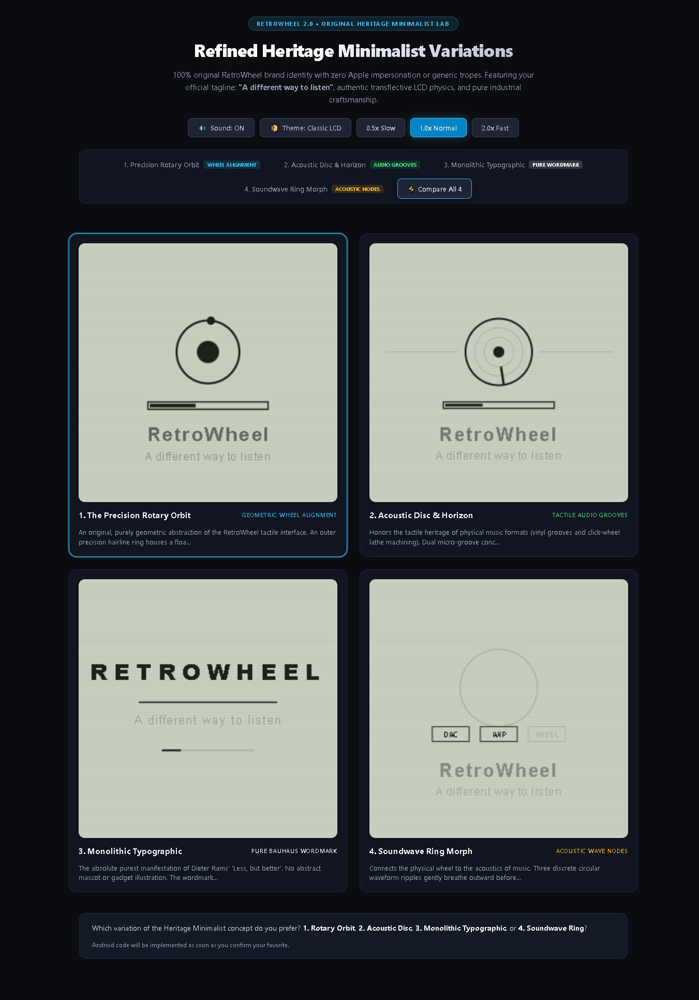
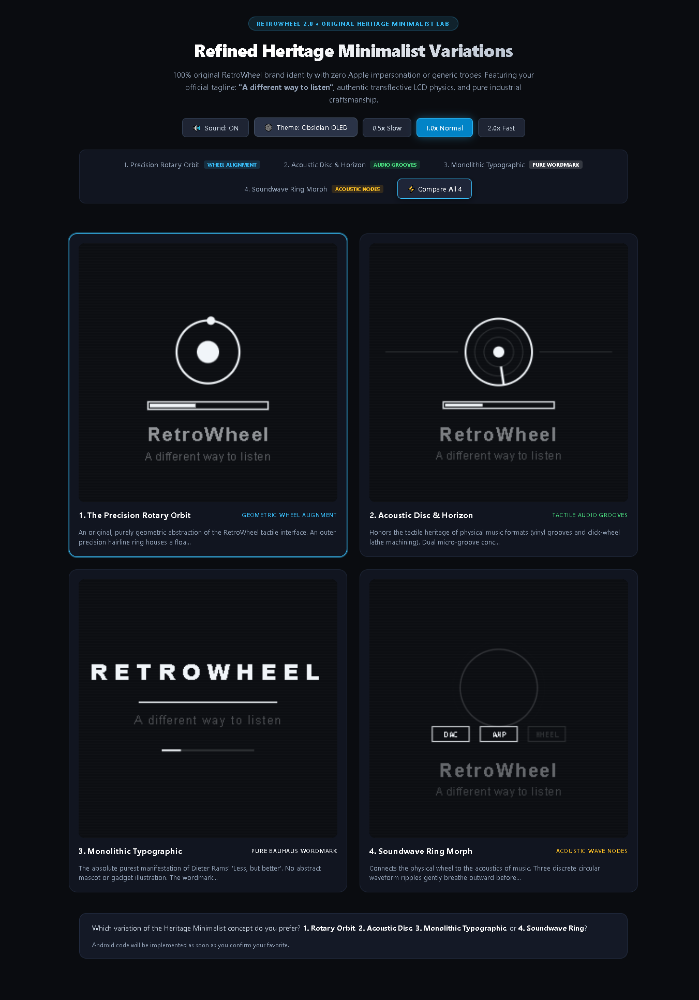

# RetroWheel — Luxury Tactile Rotary DAP for Android

<p align="center">
  
</p>

<p align="center">
  <strong>The definitive tactile click-wheel music player for Android.</strong><br>
  An authentic fusion of classic Braun industrial design (Dieter Rams) and high-end Japanese Digital Audio Players (DAPs).
</p>

<p align="center">
  <a href="https://github.com/shubhambelbase/RetroWheel-Showcase/releases/latest"></a>
  
  
  
</p>

---

## 🎧 Overview

**RetroWheel** reimagines the golden age of portable audio for modern audiophiles. Built from the ground up for Android, it pairs tactile circular thumb navigation with an uncompromising, bit-perfect audiophile DSP engine. Active listening is never interrupted by unprompted audio or full-screen ads.

<p align="center">
  
</p>

---

## ✨ Key Features

### 1. 🎛️ Contextual Rotary Click-Wheel
- **Rotational Ballistic Physics**: Native C++ momentum calculation with exponential smoothing (EMA) and authentic flywheel inertia.
- **Dual-Stage Micro-Haptics**: Independent tactile notch detents deliver a crisp physical feedback click on every discrete step.
- **Multi-Profile Acoustic Feedback**: Switch between Ceramic Mechanical Click, Soft Relay, Classic Clicker, or Silent mode.
- **Contextual Quadrants**: Top (Menu/Back), Bottom (Play/Pause), Left (Previous/Seek), Right (Next/Fast Forward), and Center Action button.

### 2. 🎚️ 10-Band Audiophile DSP & Analog Warmth
- **10-Band Precision Equalizer**: Spline-interpolated curve with tactile detents for rotary frequency band sculpting.
- **12AX7 Tube Triode Emulation**: Second-order even harmonic saturation for rich, warm acoustic presence and smooth vocal staging.
- **15-IPS Studio Tape Warmth**: Subtle analog magnetic tape hysteresis with gentle high-frequency roll-off.
- **ITU-R BS.1770 Volume Normalization**: Professional broadcast-grade loudness leveling to eliminate abrupt volume spikes.
- **Bit-Perfect Audio**: Real-time USB DAC bypass detection and live Bluetooth Hi-Res codec badges (LDAC, aptX Adaptive, AAC, SBC).

### 3. 💿 Authentic Navigation & Cover Flow
- **3D Cover Flow**: Fluid horizontal album art scrubbing with real-time perspective tilt and gesture velocity flings.
- **Split-Pane Menu Hierarchy**: Classic split-pane iPod layout with dynamic live preview cards.
- **Smart Playlists**: 25 Most Played, Recently Played, Top Rated, and 90s Music automatically generated from local listening telemetry.
- **Alphabet Scrub Overlay**: Rapid alphabet jumping when scrubbing through large multi-thousand track music libraries.

### 4. 🎨 Custom Skin Studio & Luxury Themes
- **Built-in Luxury Finishes**: Porcelain White, Precision Titanium, Stealth Black, Monochrome OLED, 24K Champagne Gold, U2 Crimson, and Midnight Sapphire.
- **Web-Based Skin Studio**: Interactive 2D/3D browser studio (`skin_studio/index.html`) to design custom `.rtskin` bundles with custom textures, wheel geometry, and color palettes.
- **Safe Import/Export**: One-click ZIP/QR import with cryptographic bundle validation and memory-safe downsampling.

---

## 📥 Download & Installation

The official production-hardened release APK is available directly on GitHub Releases:

👉 **[Download Latest Release APK](https://github.com/shubhambelbase/RetroWheel-Showcase/releases/latest)**

### Requirements
- **OS**: Android 8.0 Oreo (API level 26) up to Android 15 / 16 (API level 36).
- **Storage**: ~7.5 MB free space.
- **Permissions**: Audio file read access (`READ_MEDIA_AUDIO` on Android 13+, `READ_EXTERNAL_STORAGE` on earlier versions).

---

## 🏛️ System Architecture

RetroWheel is architected with strict separation of concerns, high-efficiency native performance, and zero main-thread audio blocking:

```text
┌────────────────────────────────────────────────────────┐
│               Jetpack Compose UI Layer                 │
│   (ClickWheel, NowPlaying, CoverFlow, MenuListScreen)  │
└───────────────────────────┬────────────────────────────┘
                            │
┌───────────────────────────▼────────────────────────────┐
│              Native C++ Core Engine (JNI)              │
│  - Ballistic Flywheel Physics & Friction Decay         │
│  - 10-Band Spline Equalizer & Harmonic Warmth Transfer │
│  - Kernel-Level Anti-Tamper & Cryptographic HMAC Token │
└───────────────────────────┬────────────────────────────┘
                            │
┌───────────────────────────▼────────────────────────────┐
│            AndroidX Media3 Audio Subsystem             │
│  - Foreground PlaybackService & MediaSessionCompat     │
│  - Low-latency AudioTrack with AudioFX Equalizer       │
│  - Real-time USB DAC & Bluetooth Codec Routing         │
└────────────────────────────────────────────────────────┘
```

---

## ⚖️ Ethical Monetization Model

RetroWheel adheres to a strict **Zero Listening Interruption Policy**:
- **100% Free Forever**: All core music playback, library browsing, Cover Flow, manual 10-band EQ, and 4 core heritage themes are free forever.
- **Zero Audio Ads**: Active playback is never interrupted by unprompted sound or popups.
- **Voluntary Passes**: Premium exotic themes and specialized analog DSP warmth curves can be unlocked for 48 hours or 7 days by watching a voluntary rewarded video ad.

---

## 📄 Documentation & Links

- [Store Metadata & Descriptions](docs/STORE_METADATA.md)
- [Privacy Policy](docs/PRIVACY_POLICY.md)
- [Skin Engine Specification (.rtskin)](docs/SKIN_ENGINE_SPEC.md)
- [Skin Studio Web Simulator](skin_studio/index.html)

---

## 🛡️ License & Intellectual Property

Copyright © 2026 RetroWheel. All rights reserved.  
The source code for this project is proprietary and maintained in a private repository. This public repository serves as the official portfolio showcase, public documentation, and release distribution channel.
