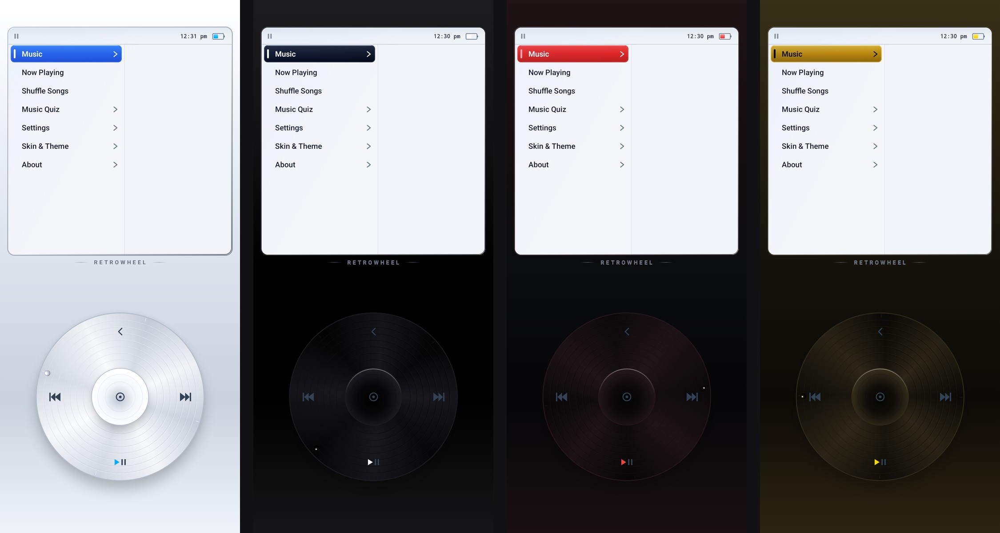
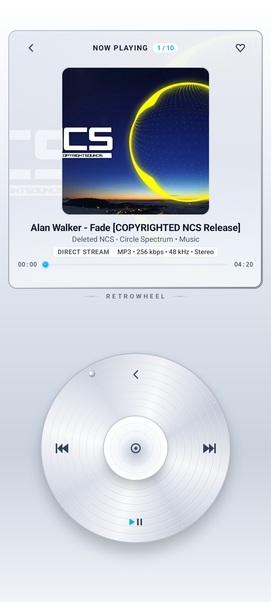
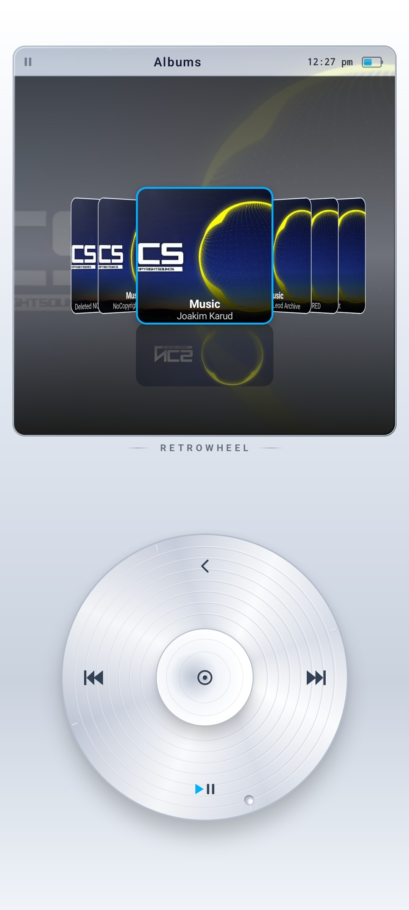
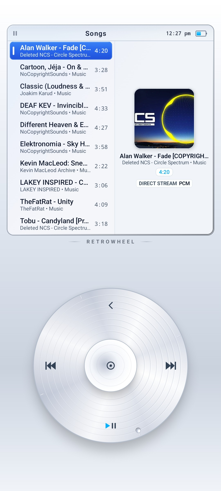
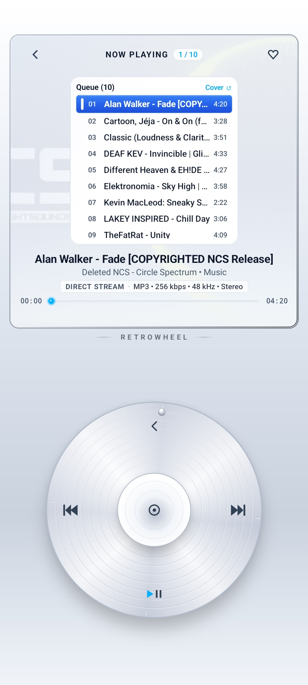
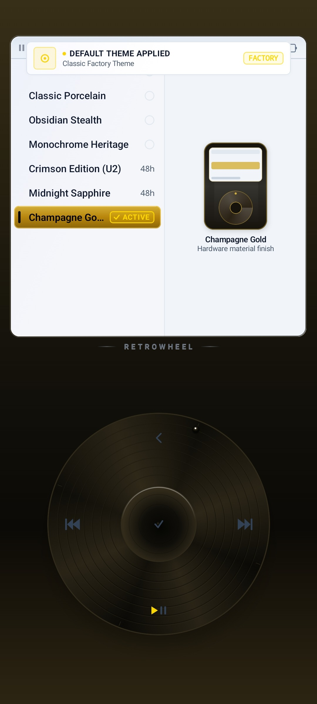
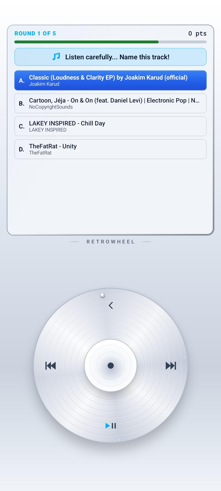
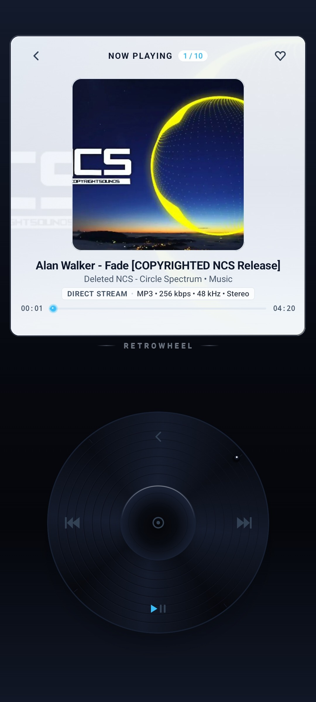
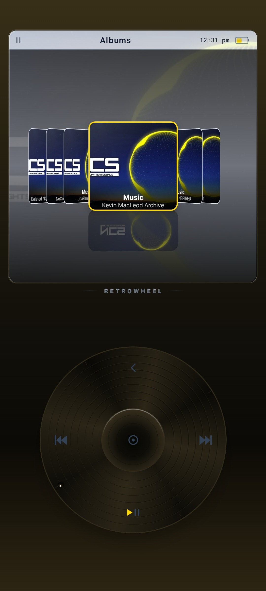
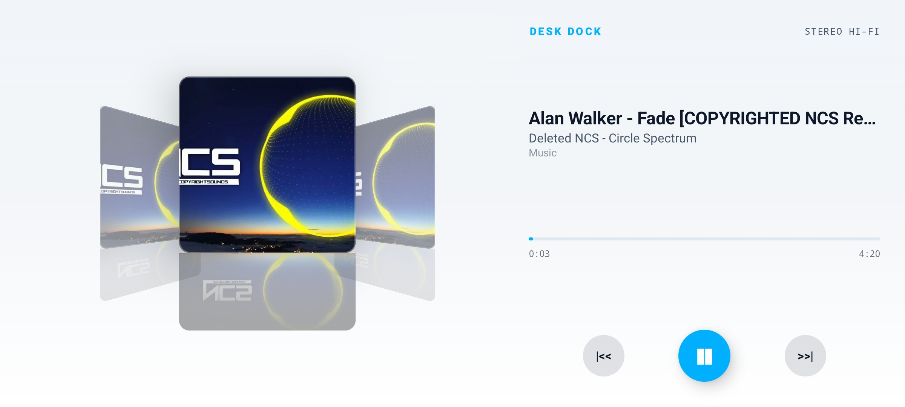

# RetroWheel

  

  <strong>An iPod Classic style click-wheel music player for Android.</strong> 
  Spin the wheel, feel the clicks, and flip through your albums in 3D Cover Flow.

  
  
  

---

## What is RetroWheel?

RetroWheel brings the classic iPod experience to your Android phone. If you miss loading your own MP3s and navigating your library with a physical-feeling click-wheel, this player is built for you.

You get a full rotary wheel that responds to your thumb with real haptic vibrations and classic audio clicks, the original 3D Cover Flow album view, split-screen menus, and a 10-band equalizer.

It plays local audio files directly from your phone (MP3, FLAC, AAC, WAV) with zero audio ads interrupting your listening.

---

## Screenshots

### Core Screens

| Now Playing | 3D Cover Flow | Songs List |
|:---:|:---:|:---:|
|  |  |  |
| Audio specs, bitrate, and progress bar | Smooth 3D album art carousel | Classic split view with album preview |

### Features and Mini-Game

| Up Next Queue | Theme Picker | Retro Music Quiz |
|:---:|:---:|:---:|
|  |  |  |
| Quick drawer showing the track queue | Pick from built-in hardware finishes | Guess the song from your library |

### Color Themes

| Obsidian Stealth (Dark) | 24K Champagne Gold |
|:---:|:---:|
|  |  |
| Pure black background for OLED screens | Brushed metallic gold wheel |

### Landscape Desk Dock Mode

Rotate your phone sideways on a desk stand or nightstand to turn it into a dedicated Hi-Fi desktop player:

  

---

## What you get

### Touch Click-Wheel
- Spin the wheel with your thumb to scroll through lists and adjust volume.
- Real vibration feedback on every tick so you feel each step.
- Four click sounds to pick from: Classic Clicker, Ceramic, Soft Relay, or Silent.
- Dedicated button quadrants for Menu, Play/Pause, Next, Previous, and center Select.

### Landscape Desk Dock
- Rotate your phone sideways at any time to switch into a full-width desktop mode.
- Shows large 3D album artwork with floor reflections, live track details, progress scrubber, and touch playback buttons.

### 3D Cover Flow
- Flip through your album covers in a 3D perspective stack.
- Flick to spin through your collection with momentum.
- Tap any album to open its tracklist.

### 10-Band Equalizer and Audio Warmth
- 10-band EQ to shape your bass, mids, and treble.
- Tube and tape saturation settings for a warmer, fuller sound.
- Volume leveling to stop loud tracks from blasting your ears.
- Direct output detection for USB DACs and Bluetooth codecs (LDAC, aptX, AAC, SBC).

### Themes
- Classic Silver / Porcelain White
- Obsidian Stealth Black (battery-friendly for OLED displays)
- U2 Special Edition (black body with red accents)
- 24K Champagne Gold
- Midnight Sapphire Blue

### Extra Features
- **Music Quiz**: The classic iPod trivia game where you hear a snippet and guess the track.
- **Smart Playlists**: Top 25 Most Played, Recently Played, and Top Rated playlists built automatically from your listening history.
- **Queue Drawer**: Tap the title on the Now Playing screen to view and jump between upcoming songs.
- **Custom Skin Studio**: A companion web editor (`skin_studio/index.html`) to build your own `.rtskin` theme packs.

---

## Download and Setup

1. Go to the [Releases](https://github.com/shubhambelbase/RetroWheel-Showcase/releases/latest) page and download `RetroWheel-Hardened-release.apk`.
2. Tap the downloaded APK on your phone to install it. If prompted, allow installations from your browser or file manager.
3. Open RetroWheel and grant storage permission when asked so it can find your local music files.
4. Put your music files in your phone's `Music` folder. Supported formats include MP3, FLAC, M4A/AAC, OGG, and WAV.

### System requirements
- Android 8.0 (Oreo) or newer.
- Works on Android 8 through Android 16.
- About 8 MB free storage for the app.

---

## How ads work

Your music is never interrupted:
- The core player, library browsing, Cover Flow, manual 10-band EQ, and default themes are completely free.
- There are no banner ads while you browse and no audio ads while listening.
- A few optional themes and analog warmth presets can be unlocked for 48 hours or 7 days by watching a voluntary rewarded video ad if you choose to.

---

## Search Tags

iPod Classic Android app, click wheel music player, Android iPod emulator, Cover Flow for Android, offline MP3 player, retro DAP, iPod style player, local music player with equalizer, haptic click wheel.

---

## Documentation

- [Store Metadata & Descriptions](docs/STORE_METADATA.md)
- [Privacy Policy](docs/PRIVACY_POLICY.md)
- [Skin Engine Specification (.rtskin)](docs/SKIN_ENGINE_SPEC.md)
- [Skin Studio Web Simulator](skin_studio/index.html)

---

## License

Copyright (c) 2026 RetroWheel. All rights reserved.  
The source code is kept in a private repository. This repository hosts public downloads, documentation, skin studio tools, and release updates.
